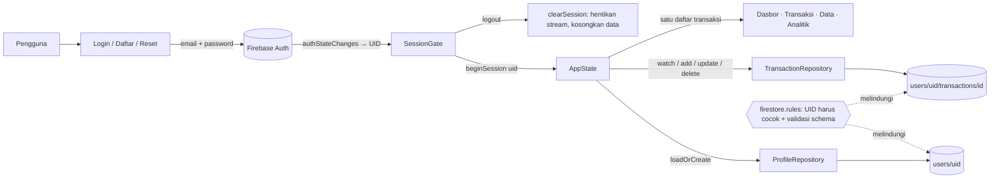

# Panduan presentasi SIMANJA — milestone backend tahap 1

Dokumen ini dipakai saat demo. Isinya mengikuti implementasi yang ada di repository per 26 November 2026, bukan rencana. Jika ada pertanyaan di luar dokumen ini, jawab berdasarkan kode dan hasil tes, jangan berdasarkan target.

## Ringkasan satu kalimat

SIMANJA adalah aplikasi Flutter untuk mencatat keuangan pribadi. Login, profil, dan transaksi tersimpan per pengguna di Firebase Auth + Cloud Firestore (diuji di Firebase Emulator). Dasbor, Data, dan Analitik dihitung dari satu sumber transaksi yang sama.

## Persiapan sebelum demo (±5 menit)

1. Dari `backend/`: `npm.cmd run emulators`. Untuk memakai data demo yang sudah diekspor, jalankan perintah import yang ada di README.
2. Dari `frontend/`: `flutter run --dart-define=USE_FIREBASE_EMULATORS=true --dart-define=FIREBASE_PROJECT_ID=demo-simanja`.
3. Siapkan dua akun, misalnya `demo.a@simanja.test` dan `demo.b@simanja.test`. Buat lewat tombol **Daftar** atau UI Auth Emulator (`http://127.0.0.1:4000`). Password demo jangan dibacakan atau ditampilkan di slide.
4. Buka UI Emulator di tab browser terpisah untuk menunjukkan dokumen Firestore.

## Skenario demo (±7 menit)

| # | Langkah | Yang ditunjukkan | Poin bicara |
| --- | --- | --- | --- |
| 1 | Buka aplikasi → Splash → Intro → Login | Alur awal tanpa jalan pintas ke Home | Route `/home` dilindungi auth gate |
| 2 | Login sebagai akun A (akun baru) | Dasbor, Transaksi, Data, Analitik kosong | Akun baru tidak diisi data dummy |
| 3 | Tambah 1 pemasukan dan 2 pengeluaran | Kartu arus kas, transaksi terbaru, dan ringkasan aktivitas langsung berubah | Form menunggu konfirmasi server sebelum menutup |
| 4 | Buka **Data**: cari, filter bulan, urutkan, ekspor CSV | Total tabel mengikuti filter; share sheet CSV | CSV dibuat di perangkat sesuai filter aktif |
| 5 | Buka **Analitik**: ganti bulan akhir | Grafik 6 bulan, rasio tabungan, kategori | Rasio “—” bila pemasukan nol |
| 6 | Edit lalu hapus satu transaksi | Semua halaman ikut berubah | Edit memakai ID stabil, bukan indeks |
| 7 | UI Emulator → `users/{uidA}/transactions` | Dokumen tersimpan per UID | `amount` disimpan sebagai integer rupiah |
| 8 | Profil: ubah nama dan tema → simpan | Pesan sukses setelah write selesai | Email read-only karena berasal dari Auth |
| 9 | Tutup lalu buka aplikasi | Sesi pulih, data dan tema tetap | Persistensi berasal dari Auth + Firestore |
| 10 | Logout → tekan Back | Tidak kembali ke Home | Stack navigasi dibersihkan, stream dihentikan |
| 11 | Login akun B | Data kosong, data A tidak terlihat | Isolasi ditegakkan oleh rules, tidak hanya oleh UI |
| 12 | (Opsional) `npm.cmd test` dari `backend/` | 66 tes rules/Auth lulus | Tes memakai client pemilik, akun lain, dan anonim |

Cadangan bila emulator bermasalah: tunjukkan hasil `flutter test` (187 tes) dan `npm.cmd test` (66 tes). Jelaskan bahwa demo memakai emulator, bukan project cloud.

## Alur data Firebase

Versi teks: Auth memberikan UID → `SessionGate` memanggil `AppState.beginSession` → repository membaca/menulis `users/{uid}` dan `users/{uid}/transactions` → satu stream mengisi semua halaman. Saat logout atau pergantian akun, stream dibatalkan dan data dikosongkan sebelum akun berikutnya dimuat.

## Status fitur

| Fitur | Status | Catatan |
| --- | --- | --- |
| Login, daftar, reset password, logout | **Cloud (Auth)** | Diuji di Auth Emulator; reset menghasilkan tautan lokal, bukan email sungguhan |
| Sesi dan auth gate | **Cloud (Auth)** | Cold start, logout + Back, route `/home` langsung, dan ganti akun diuji lewat widget test dengan Auth tiruan; login ulang dan persistensi diuji di Auth Emulator |
| Profil teks dan preferensi tema/ringkasan | **Cloud (Firestore)** | `users/{uid}`; dimuat saat sesi dibuka, belum realtime antarperangkat |
| CRUD transaksi | **Cloud (Firestore)** | `users/{uid}/transactions`; status loading/cache/pending/error |
| Dasbor, Data, Analitik | **Dihitung di perangkat** | Dari stream transaksi yang sama; tidak ada sumber dummy kedua |
| Ekspor CSV | **Lokal** | Dibuat di perangkat lalu dibagikan lewat share sheet |
| Ringkasan aktivitas (ikon lonceng) | **Lokal** | Diturunkan dari transaksi periode terpilih; bukan push notification/FCM |
| Foto profil | **Lokal** | Hanya pada sesi/perangkat; dihapus saat logout; belum memakai Storage |
| Rekening dan aset | **Data contoh** | Berlabel “Data contoh”; tidak berubah karena CRUD transaksi |
| Security rules | **Diuji di emulator** | 66 tes otomatis; belum di-deploy ke project asli |

## Pembagian kontribusi

| Anggota | Cakupan | Commit utama |
| --- | --- | --- |
| Anggota 1 (Fuad) | Baseline repo, tema/komponen bersama, model dan kontrak `AppState`, utilitas `finance_summary`, navigasi enam menu, dasbor, aset, ringkasan aktivitas, integrasi akhir A8 | A1–A8 |
| Anggota 2 (Wein) | Form dan daftar transaksi, tabel Data, ekspor CSV, analitik, profil, dan foto lokal, ditambah perbaikan lanjutan | B1–B8 dan commit `fix(...)` lanjutan |
| Anggota 3 (Michael) | Firebase bootstrap dan emulator, Auth, auth gate dan sesi, profil Firestore, repository dan sinkronisasi transaksi, rules, tes emulator, dokumentasi backend | C1–C8 dan penanganan error lanjutan |

## Menjawab pertanyaan tentang batas fitur

- **“Backend sudah selesai?”** Belum. Tahap 1 mencakup Auth, profil, dan transaksi per pengguna beserta rules dan tesnya. Angka “sekitar 50%” adalah batas milestone, bukan persentase kode.
- **“Sudah terhubung ke Firebase asli?”** Belum. Semua pengujian memakai Firebase Emulator dengan project `demo-simanja`. Langkah menghubungkan project asli ada di README, tetapi belum dijalankan dan rules belum di-deploy.
- **“Kenapa saldo rekening/aset tidak berubah saat menambah transaksi?”** Model transaksi belum menyimpan rekening, jadi rekening dan aset masih data contoh dan diberi label. Mutasi saldo masuk backlog tahap 2.
- **“Bagaimana akun A tidak bisa melihat data akun B?”** Path data memakai UID, dan `firestore.rules` menolak akses jika UID sesi berbeda. Penolakan ini dibuktikan oleh tes otomatis dengan client akun lain dan client anonim, tidak hanya disembunyikan di UI.
- **“Password disimpan di mana?”** Dikelola Firebase Auth. Password tidak ditulis ke Firestore, `AppState`, atau log.
- **“Kalau offline?”** Data dapat tampil dari cache SDK disertai banner “cache/offline”. Write yang belum dikonfirmasi ditandai “menunggu konfirmasi server”. Pendaftaran, bootstrap profil, dan create transaksi membutuhkan koneksi. Belum ada antrean offline khusus.
- **“Notifikasinya push?”** Bukan. Isinya ringkasan dalam aplikasi yang dihitung dari transaksi periode yang dipilih. FCM masuk backlog.
- **“Grafik dihitung di server?”** Tidak. Semua agregasi dihitung di perangkat oleh `finance_summary.dart`, sehingga Dasbor, Data, dan Analitik selalu konsisten.
- **“Foto profil tersimpan di cloud?”** Tidak. Foto masih lokal dan dikosongkan saat logout/ganti akun. Firebase Storage masuk tahap 2.
- **“Apa saja yang sudah diuji?”** Lihat tabel di bawah. iOS, perangkat fisik, dan project cloud asli belum diuji.

## Hasil pemeriksaan A8 (26 November 2026)

| Pemeriksaan | Hasil |
| --- | --- |
| `flutter analyze --no-pub` | Bersih |
| `flutter test --no-pub` | 187 tes lulus, termasuk 18 tes regresi layout/rotasi/periode baru |
| `npm.cmd test` (`backend/`, emulator Auth + Firestore) | 66 tes lulus |
| `flutter build apk --debug --no-pub` | Berhasil |
| Uji manual alur lengkap | Belum dijalankan pada A8; dijadwalkan di HP Android sebelum presentasi |
| iOS, project Firebase asli | Belum diuji |

Untuk uji di HP: HP dan laptop harus di Wi-Fi yang sama. Jalankan emulator Firebase dari `backend/`, lalu dari `frontend/` jalankan `flutter run --dart-define=USE_FIREBASE_EMULATORS=true --dart-define=FIREBASE_PROJECT_ID=demo-simanja --dart-define=FIREBASE_EMULATOR_HOST=IP_LAN_LAPTOP`. Emulator Auth dan Firestore sudah listen di `0.0.0.0` (`backend/firebase.json`), tetapi Firewall Windows tetap perlu mengizinkan port 9099 dan 8080.

Regresi integrasi yang diperbaiki pada A8:

- Overflow horizontal pada layar 320/360/412 dan skala teks 1,5 di judul kartu Dasbor (“Arus Kas Transaksi”, “Total Nilai Aset”), judul seksi Profil, judul “Detail Aset”, dan nominal kartu transaksi.
- State keenam tab hilang saat rotasi (pergantian bottom bar ↔ NavigationRail). Halaman sekarang dipertahankan.
- Filter periode Dasbor bisa tertinggal pada bulan yang sudah tidak tampil setelah CRUD menggeser rentang chip. Filter sekarang kembali ke “Semua”.
- Avatar Dasbor kosong ketika file foto lokal hilang. Sekarang avatar memakai ikon fallback seperti di Profil, dengan area sentuh dan label aksesibilitas.
- Tes navigasi tidak lagi mengabaikan overflow Dasbor.

## Backlog tahap 2

1. Rekening dan aset di cloud, termasuk relasi transaksi → rekening dan mutasi saldo.
2. Anggaran bulanan dan target tabungan.
3. Firebase Storage untuk foto profil per UID.
4. Push notification (FCM) dan pengingat terjadwal.
5. Cloud Functions untuk agregasi atau laporan server dan ekspor cloud.
6. Penghapusan akun dan data secara menyeluruh, serta perubahan email terverifikasi.
7. Profil realtime antarperangkat dan dukungan offline yang lebih lengkap.
8. Konfigurasi project Firebase asli, deploy rules, dan pengujian di iOS serta perangkat fisik.
